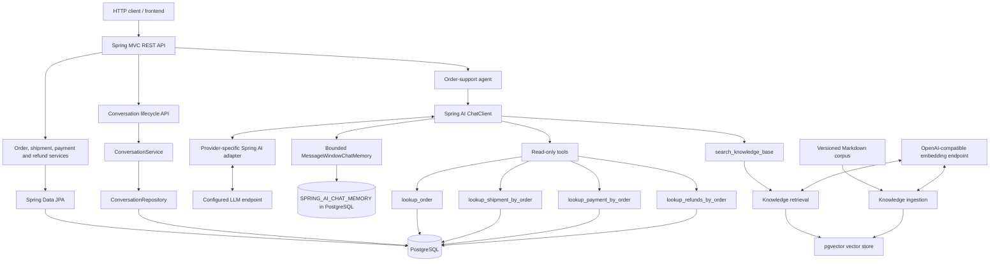

# Knowledge Agent

A Java 25 / Spring Boot service for order lifecycle management and AI-assisted order support. It combines a conventional REST API and PostgreSQL-backed domain model with a read-only LLM agent that retrieves transactional facts through application-owned tools.

> **Project status:** Active development. The order, shipment, payment, refund, and conversation flows use application-owned tools and PostgreSQL-backed storage. The agent also supports an optional RAG knowledge base for versioned policy and process documents. Automated testing and operational hardening are in progress; run the test suite before treating a branch as release-ready.

## Features

### Order-management API

- Create and retrieve orders and list a customer's orders.
- Transition orders into processing or cancel eligible orders.
- Dispatch shipments and mark shipments as delivered.
- Register captured payments and request partial or full refunds.
- Use an idempotency key when requesting a refund.
- Validate incoming requests and return structured API errors.

### AI order-support agent

- `POST /api/v1/agent/chat` accepts a user message and optional `conversationId`.
- Returns a JSON response containing `conversationId` and a Markdown-capable `answer`.
- Uses Spring AI `ChatClient` with provider-neutral settings (`LLM_BASE_URL`, `LLM_API_KEY`, `LLM_MODEL`) and a provider-specific adapter profile.
- Supports follow-up questions with a bounded `MessageWindowChatMemory` backed by Spring AI `JdbcChatMemoryRepository` and PostgreSQL.
- Uses the conversation history to resolve references such as "its tracking number", but calls the relevant tool for current transactional facts.
- Persists conversation metadata and status in PostgreSQL; a conversation can be closed through a dedicated endpoint.
- Rejects attempts to continue a closed conversation with HTTP `409 Conflict`.
- Is read-only: the model cannot create, cancel, ship, or refund orders.

The four application-owned tools are:

| Tool | Information returned |
|---|---|
| `lookup_order` | Order status, customer ID, total, currency, and item details |
| `lookup_shipment_by_order` | Shipment status, carrier, tracking number, and shipping/delivery timestamps |
| `lookup_payment_by_order` | Payment status, amount, currency, refunded amount, and capture timestamp |
| `lookup_refunds_by_order` | Recent refund records and lifecycle timestamps |

The model has no database credentials and does not connect directly to PostgreSQL. Tool calls are executed by the application and return bounded results to the model.

### RAG knowledge base

An optional `rag` profile adds retrieval-augmented generation (RAG) for policy and process questions. It is separate from the transactional tools above: the knowledge base answers questions about documented rules, while order-specific shipment, payment, and refund status must still come from the live transactional tools.

- Loads versioned Markdown documents from `src/main/resources/knowledge/`; the current examples are `shipping-policy.md`, `refund-policy.md`, and `warranty-policy.md`.
- Uses an OpenAI-compatible embedding endpoint independently of the chat-model provider. The current configuration uses `text-embedding-3-small` with 1,536 dimensions.
- Stores document embeddings and source metadata in PostgreSQL with pgvector. The schema is managed by Flyway; the Spring AI vector-store schema auto-initializer is disabled.
- Exposes the read-only `search_knowledge_base` tool. It returns document excerpts with source name, source ID, version, and chunk metadata so the model can formulate an answer grounded in retrieved content.
- The current retrieval defaults are `top-k: 5` and `similarity-threshold: 0.35`; tune them using retrieval evaluation rather than changing them solely to improve one example answer.
- The policy files are demonstration content, not authoritative customer policy. Replace them with approved documents before using the agent for real customer support.

The RAG retrieval result is evidence for the answer, not a substitute for a transactional lookup. For example, a return-window question can be answered from the Refund Policy; the refund status for a particular order must be checked with the refund tools.

### Observability and error handling

- `X-Correlation-ID` is accepted when valid, generated when absent or invalid, and returned in the HTTP response header.
- The correlation ID is added to logging MDC and removed after the request to avoid leaking context across reused servlet threads.
- Micrometer instrumentation records agent request counts/durations and tool-call counts/durations, labelled by bounded outcome/tool values.
- AI provider failures are mapped to structured API errors rather than returning raw upstream exception messages.
- Actuator health and metrics endpoints are configured in the application. If the Prometheus registry dependency is enabled, the Prometheus scrape endpoint is available too.

**Memory persistence boundary:** bounded chat-memory messages are stored in PostgreSQL and survive application restarts. Closing a conversation clears its stored memory. Spring AI 2.0.1 `JdbcChatMemoryRepository` filters assistant messages containing tool calls and `ToolResponseMessage` records, so this is contextual memory, not a complete audit transcript of every model/tool exchange. If full tool-call replay or an immutable audit history is required, implement a separate conversation event/history store rather than relying on `ChatMemoryRepository`.

## Technology stack

- Java 25
- Spring Boot 4.1.1
- Spring AI 2.0.1
- Spring MVC and Jakarta Bean Validation
- Spring Data JPA / Hibernate
- PostgreSQL 17
- Flyway migrations and seed data
- Docker Compose for local PostgreSQL
- Spring Boot Actuator and Micrometer
- Spring AI JDBC chat-memory repository
- Spring AI pgvector vector store and OpenAI-compatible embeddings for RAG
- JUnit 5, Mockito, AssertJ, and Testcontainers
- An LLM endpoint compatible with the selected Spring AI provider adapter; the current local setup uses an Anthropic-compatible proxy on port `6655`

## Architecture



The model chooses whether tools are needed. The application executes each selected tool and returns its result to the model. A conversation ID carries context across requests; it does not replace a fresh tool lookup for current transactional data.

## Prerequisites

- JDK 25
- Docker Engine / Docker Desktop with Docker Compose
- Maven installed and available as `mvn`
- A local LLM proxy running on port `6655`, configured with an available model and compatible tool calling
- `curl` and `jq` for the API examples and the live evaluation script
- [`glow`](https://github.com/charmbracelet/glow) to render Markdown responses and pretty-printed JSON in the terminal
- IntelliJ IDEA or another Java IDE (optional)

## Run locally

### 1. Start PostgreSQL

From the repository root:

```bash
docker compose up -d
docker compose ps | glow -
```

The Compose configuration and Spring datasource settings must agree on the host port, database name, username, and password. The development configuration connects to PostgreSQL at `localhost:5432` and uses the `knowledge_agent` database. Keep local credentials out of committed files if you change them.

### 2. Configure the local profile and LLM endpoint

The configuration is split into three layers:

- `src/main/resources/application.yml` contains shared application, datasource, JPA, Flyway, server, Actuator, logging, and agent settings.
- `src/main/resources/application-local.yml` contains local datasource and LLM endpoint defaults using provider-neutral `LLM_*` variables.
- `src/main/resources/application-anthropic.yml` maps `knowledge-agent.llm.*` into Spring AI Anthropic-specific properties.

For the local LLM proxy, activate both the `local` and `anthropic` profiles. In IntelliJ, open **Run → Edit Configurations → Environment variables** and set:

```dotenv
SPRING_PROFILES_ACTIVE=local,anthropic
LLM_BASE_URL=http://localhost:6655/anthropic
LLM_API_KEY=local-LLM-proxy
LLM_MODEL=<model alias supported by your proxy>
LLM_TIMEOUT=30s
LLM_MAX_TOKENS=2048
```

`local-LLM-proxy` is only a placeholder for a local proxy that accepts a dummy bearer token. Use the credential required by your proxy if authentication is enabled. `LLM_MODEL` must match an alias actually supported by the running proxy; do not assume that a public provider model ID is available.

The neutral local settings are equivalent to:

```yaml
knowledge-agent:
  llm:
    base-url: ${LLM_BASE_URL:http://localhost:6655/anthropic}
    api-key: ${LLM_API_KEY:local-LLM-proxy}
    model: ${LLM_MODEL}
    timeout: ${LLM_TIMEOUT:30s}
    max-tokens: ${LLM_MAX_TOKENS:2048}
```

The provider adapter maps these settings to the selected protocol's Spring AI properties. To use another provider, add the corresponding Spring AI starter and adapter profile; changing only the URL is not sufficient when the upstream protocol differs. The endpoint must support the capabilities used by the agent, particularly tool calling.

### 3. Configure embeddings for the RAG profile (optional)

RAG uses a separate OpenAI-compatible embedding endpoint; it does not require the chat model itself to be OpenAI. Keep the chat-provider profiles you already use and add `rag`. For the local Hyperspace proxy on port `6655`, the example below assumes you use the documented `local` and `anthropic` chat profiles:

```dotenv
SPRING_PROFILES_ACTIVE=local,anthropic,rag
EMBEDDING_BASE_URL=http://localhost:6655/openai/v1
EMBEDDING_API_KEY=local-embedding-proxy
EMBEDDING_MODEL=text-embedding-3-small
```

Use the API key accepted by your proxy. `EMBEDDING_BASE_URL` must be the OpenAI-compatible API base URL ending in `/openai/v1`, not the individual `/embeddings` endpoint. If you use another chat provider, keep that provider's required profile enabled alongside `rag`.

The embedding model must produce 1,536-dimensional vectors to match the `knowledge_vectors` schema. The RAG profile configures pgvector with schema initialization disabled because Flyway owns the database schema. Start PostgreSQL and apply migrations before starting the application with RAG enabled.

Do not commit actual credentials or secrets. `application-local.yml` should contain only environment-variable references and harmless local defaults. If your local files differ from these examples, merge the settings instead of replacing unrelated configuration.

### 4. Start the service

```bash
mvn spring-boot:run
```

Check application health and render the JSON response clearly:

```bash
curl -sS http://localhost:8080/actuator/health \
  | jq '.' \
  | glow -
```

Build and run the tests:

```bash
set -o pipefail
mvn clean verify 2>&1 | glow -
```

Integration tests that use Testcontainers require Docker to be available. Resolve compiler errors, failing tests, or context-startup failures before pushing; a successful compilation alone does not prove that integration tests are green.

## API overview

All endpoints use the `/api/v1` prefix.

| Method | Endpoint | Purpose |
|---|---|---|
| `POST` | `/orders` | Create an order |
| `GET` | `/orders/{orderId}` | Retrieve an order with its items |
| `GET` | `/customers/{customerId}/orders` | List a customer's orders |
| `POST` | `/orders/{orderId}/processing` | Start order processing |
| `POST` | `/orders/{orderId}/cancellation` | Cancel an eligible order |
| `POST` | `/orders/{orderId}/shipment` | Dispatch an order |
| `GET` | `/shipments/{shipmentId}` | Retrieve a shipment |
| `GET` | `/orders/{orderId}/shipment` | Retrieve an order's shipment |
| `POST` | `/shipments/{shipmentId}/delivery` | Mark a shipment as delivered |
| `POST` | `/orders/{orderId}/payment` | Register a captured payment |
| `GET` | `/payments/{paymentId}` | Retrieve a payment |
| `GET` | `/orders/{orderId}/payment` | Retrieve an order's payment |
| `POST` | `/payments/{paymentId}/refunds` | Request a refund; requires `Idempotency-Key` |
| `GET` | `/refunds/{refundId}` | Retrieve a refund |
| `POST` | `/agent/chat` | Send a message and receive an answer plus `conversationId` |
| `POST` | `/agent/conversations/{conversationId}/close` | Close a conversation and delete its stored chat memory |
| `GET` | `/actuator/health` | Application health |
| `GET` | `/actuator/metrics` | List available Micrometer metrics |
| `GET` | `/actuator/metrics/{metricName}` | Inspect a specific metric |

### Terminal output conventions

Use `jq` to format JSON, and `glow` to render Markdown. For structured JSON API responses, use:

```bash
curl -sS http://localhost:8080/api/v1/orders/1 \
  | jq '.' \
  | glow -
```

For the agent's Markdown answer, extract the string rather than printing the whole JSON envelope:

```bash
printf '%s\n' "$AGENT_RESPONSE" | jq -r '.answer' | glow -
```

This keeps `conversationId` and other envelope fields separate from the human-readable answer. If `glow` is not installed, the JSON can still be formatted with `jq '.'`; Markdown answers can be printed with `jq -r '.answer'`.

### Example: ask for a complete order summary

The seeded Order #1 is intended for local smoke testing. In the current seed data it contains a laptop and a USB-C docking station, has a total of EUR 720.00, and is in `SHIPPED` status. Its shipment is `IN_TRANSIT` with carrier `DHL` and tracking number `DHL-DEMO-ORDER-1`. The payment is `CAPTURED`; no refund records are seeded for this order. The model should retrieve each relevant fact via its tool rather than relying on the prompt or a hard-coded answer.

```bash
MESSAGE='Give me a complete status summary for order 1, including its items, shipment, payment and refund history.'

FIRST_RESPONSE=$(curl -sS \
  -X POST http://localhost:8080/api/v1/agent/chat \
  -H 'Content-Type: application/json' \
  -H 'X-Correlation-ID: order-summary-demo-001' \
  -d "$(jq -n --arg message "$MESSAGE" '{message: $message}')")

# Print the JSON metadata envelope in pretty format.
printf '%s\n' "$FIRST_RESPONSE" \
  | jq '{conversationId: .conversationId}' \
  | glow -

# Render the actual Markdown answer.
printf '%s\n' "$FIRST_RESPONSE" \
  | jq -r '.answer' \
  | glow -

CONVERSATION_ID=$(printf '%s\n' "$FIRST_RESPONSE" | jq -r '.conversationId')
printf 'Conversation ID: %s\n' "$CONVERSATION_ID"
```

The response envelope has this shape (the answer below is illustrative; natural-language formatting can vary by model):

```json
{
  "conversationId": "<generated-uuid>",
  "answer": "Markdown answer returned by the agent"
}
```

### Example: ask a documented policy question with RAG

With PostgreSQL running, the policy corpus loaded, and the application started with the `rag` profile, ask a question whose answer is present in the documents:

```bash
MESSAGE='What is the return window according to the documented policy?'

curl -sS \
  -X POST http://localhost:8080/api/v1/agent/chat \
  -H 'Content-Type: application/json' \
  -d "$(jq -n --arg message "$MESSAGE" '{message: $message}')" \
  | jq -r '.answer' \
  | glow -
```

For the demonstration Refund Policy version 1.0, the supported return window is **30 calendar days from delivery**. A good response should answer that directly and identify the source and version; it should not dump raw `SOURCE`/`EXCERPT` blocks. The exact prose can vary by model. The policy is illustrative and must not be treated as a real customer policy.

### Example: follow up using the conversation ID

Ask for the tracking number without repeating the order ID. The agent should resolve "its" from the conversation history and call `lookup_shipment_by_order` for the current shipment facts.

```bash
SECOND_RESPONSE=$(curl -sS \
  -X POST http://localhost:8080/api/v1/agent/chat \
  -H 'Content-Type: application/json' \
  -H "X-Correlation-ID: order-followup-001" \
  -d "$(jq -n \
    --arg conversationId "$CONVERSATION_ID" \
    --arg message 'What is its tracking number?' \
    '{conversationId: $conversationId, message: $message}')")

printf '%s\n' "$SECOND_RESPONSE" \
  | jq '{conversationId: .conversationId}' \
  | glow -

printf '%s\n' "$SECOND_RESPONSE" \
  | jq -r '.answer' \
  | glow -
```

### Example: close a conversation

```bash
CLOSE_STATUS=$(curl -sS -o /dev/null -w '%{http_code}' \
  -X POST \
  "http://localhost:8080/api/v1/agent/conversations/$CONVERSATION_ID/close")

printf 'HTTP_STATUS=%s\n' "$CLOSE_STATUS"
```

A successful close returns `204 No Content`. A later chat request using that closed ID returns `409 Conflict`; an unknown conversation ID returns `404 Not Found`.

To display the JSON error body from a rejected follow-up, keep the HTTP status separate from the JSON stream:

```bash
ERROR_FILE=$(mktemp)
HTTP_STATUS=$(curl -sS -o "$ERROR_FILE" -w '%{http_code}' \
  -X POST http://localhost:8080/api/v1/agent/chat \
  -H 'Content-Type: application/json' \
  -d "$(jq -n \
    --arg conversationId "$CONVERSATION_ID" \
    --arg message 'What is the order status?' \
    '{conversationId: $conversationId, message: $message}')")

printf 'HTTP_STATUS=%s\n' "$HTTP_STATUS"
jq '.' "$ERROR_FILE" | glow -
rm -f "$ERROR_FILE"
```

### Example: inspect agent metrics

The custom metric names are `knowledge.agent.requests`, `knowledge.agent.request.duration`, `knowledge.agent.tool.calls`, and `knowledge.agent.tool.duration`. Metric data appears after relevant requests have been processed.

```bash
curl -sS 'http://localhost:8080/actuator/metrics/knowledge.agent.requests' \
  | jq '.' \
  | glow -

curl -sS \
  'http://localhost:8080/actuator/metrics/knowledge.agent.tool.calls?tag=tool:lookup_order' \
  | jq '.' \
  | glow -
```

Use `X-Correlation-ID` to tie a client request to the application logs. Valid IDs are echoed back; missing or invalid IDs are replaced with a generated UUID. Do not use order IDs, conversation IDs, user input, or other high-cardinality values as metric tags.

### Example: create an order

```bash
curl -sS -X POST http://localhost:8080/api/v1/orders \
  -H 'Content-Type: application/json' \
  -d '{
    "customerId": 1,
    "currency": "EUR",
    "items": [
      {
        "productId": "SKU-API-001",
        "productName": "API test product",
        "quantity": 2,
        "unitPrice": 49.50
      }
    ]
  }' \
  | jq '.' \
  | glow -
```

Use a customer ID that exists in your local database. The endpoint expects a valid customer and a non-empty list of valid items. The request JSON is formatted for readability; the response is parsed and pretty-printed before it reaches the terminal.

## Database migrations and seed data

Flyway manages schema creation and local seed data. Migrations are under `src/main/resources/db/migration` and run on application startup. Conversation metadata is created by the conversation migration. Spring AI chat-memory messages are stored separately in `SPRING_AI_CHAT_MEMORY`, managed by a dedicated Flyway migration.

A useful check for order totals is:

```sql
SELECT
    o.id,
    o.status,
    o.total_amount,
    o.currency,
    COUNT(oi.id) AS item_count,
    COALESCE(SUM(oi.quantity * oi.unit_price), 0) AS items_total,
    o.total_amount - COALESCE(SUM(oi.quantity * oi.unit_price), 0) AS difference
FROM orders o
         LEFT JOIN order_items oi ON oi.order_id = o.id
GROUP BY o.id, o.status, o.total_amount, o.currency
ORDER BY o.id;
```

The local development database can be recreated if you intentionally want to discard its state:

```bash
docker compose down -v
docker compose up -d
mvn spring-boot:run
```

> **Warning:** `docker compose down -v` removes Compose-managed volumes and permanently deletes the local PostgreSQL data in those volumes. Do not use it against a database containing data you need. Treat an applied migration as immutable in shared/persistent environments and add a new migration for later changes.

## Testing

Run the complete suite with:

```bash
set -o pipefail
mvn clean test 2>&1 | glow -
```

The test suite includes unit tests for domain services and tools, API error mapping, chat memory/conversation lifecycle, PostgreSQL-backed chat-memory persistence, observability, request correlation, and scripted-model tool calling. Integration tests use Testcontainers and require a functioning Docker installation. Tests that exercise the LLM agent's tool loop should use a scripted/fake `ChatModel` so they do not need a running provider or paid API calls.

## Live agent evaluation

`scripts/evaluate-agent.sh` is a black-box smoke/evaluation suite for a locally running service and configured LLM provider. It checks the model-plus-tools workflow against the seeded Order #1 data, conversation follow-up resolution, payment lookup, empty refund history, and unknown-order handling. It validates required facts rather than exact prose because model wording can vary.

Run it from the repository root after starting PostgreSQL and the Spring Boot application with the local LLM provider configured:

```bash
chmod +x scripts/evaluate-agent.sh
set -o pipefail
./scripts/evaluate-agent.sh 2>&1 | glow -
```

To use a different application URL or increase the request timeout:

```bash
BASE_URL=http://localhost:8080 REQUEST_TIMEOUT_SECONDS=120 \\
  ./scripts/evaluate-agent.sh 2>&1 | glow -
```

The script makes real LLM requests and may consume provider capacity. It is a development/acceptance check, not a deterministic unit test. Keep the scripted `ChatModel` tests for deterministic tool-calling and CI validation. The script exits non-zero if an expected fact is missing or an API request fails. It prints each Markdown answer with `glow` and the final evaluation report as pretty JSON through `jq` and `glow`.

## Development principles

- Keep business rules in domain/services, not in controllers or model prompts.
- Give the model explicit tools instead of direct access to the database.
- Use conversation history for reference resolution; use tools for current transactional facts.
- Keep tool names and metric tags bounded; never tag metrics with order IDs, conversation IDs, or user-supplied values.
- Prefer read-only tools; validate and authorize any future mutation tool in application code.
- Keep provider-neutral settings externalized and protocol-specific mappings in adapter profiles.
- Test failure paths, concurrency, idempotency, conversation closure, and tool execution—not just successful HTTP requests.
- Never log API keys, full prompts, full model responses, tracking numbers, payment data, or other transactional details unnecessarily.
- Do not commit secrets, generated build output, local database files, or machine-specific IDE configuration.

## Roadmap

- [ ] Fix and verify the full test suite after observability instrumentation and tool package refactoring.
- [ ] Add provider error/timeout integration tests and enforce an overall agent-request deadline across model/tool iterations.
- [ ] Expand the live evaluation scenarios and add provider-independent regression tests for tool selection, missing records, multi-tool questions, and follow-up resolution.
- [ ] Add a separate full-fidelity conversation audit/history store if tool-call replay or compliance-grade conversation history becomes a requirement.
- [ ] Add tracing/exporter configuration if distributed traces are needed beyond request correlation IDs and Micrometer metrics.
- [ ] Add retrieval and answer-grounding evaluation for RAG, including source attribution, irrelevant results, and questions not answered by the corpus.
- [ ] Add MCP integration tests, CI build/test workflows, and final operational documentation.

## Security notes

- Keep local credentials out of Git. Commit only environment-variable references and harmless development defaults.
- Review `git status` and `git diff --cached` before pushing to ensure no API keys, proxy tokens, service keys, personal data, or local configuration have been staged.
- The example datasource credentials are for local development only and must not be reused in a deployed environment.
- Treat tool arguments and model output as untrusted. Enforce input validation, authorization, and business rules in application code.
- Persisted chat memory is not an authorization boundary. If the API is exposed to multiple users, bind each conversation to an authenticated principal and enforce ownership before allowing reuse or closure. Also define a retention policy for stored chat-memory rows; do not keep conversation context indefinitely by default.

## License

This project is licensed under the MIT License.

Copyright (c) 2026 Stefan Baychev.
