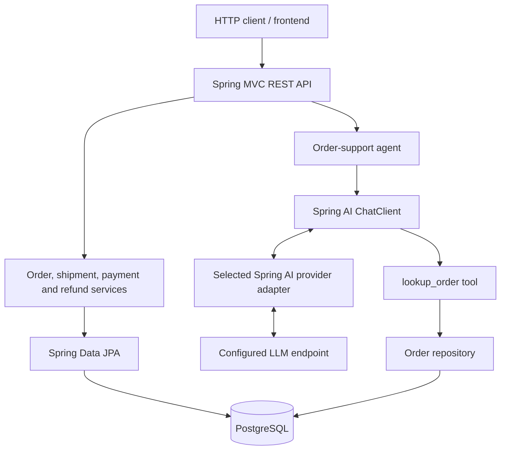

# Knowledge Agent

A Java 25 / Spring Boot service for order lifecycle management and AI-assisted order support. The project combines a conventional domain-driven REST API with a read-only LLM agent that can look up order information through an application-owned tool.

> **Project status:** active development. The order, shipment, payment, refund, and first order-support agent slices are implemented. The next steps are to extend the agent with additional read-only tools, strengthen automated tests, and add evaluation and observability.

## What it does

### Order-management API

- Create and retrieve orders and list a customer's orders.
- Transition orders into processing or cancel eligible orders.
- Dispatch shipments and mark shipments as delivered.
- Register captured payments and request partial or full refunds.
- Use an idempotency key when requesting a refund.
- Validate incoming requests and return structured API errors.

### AI order-support agent

- Exposes a chat endpoint at `POST /api/v1/agent/chat`.
- Uses Spring AI `ChatClient` with provider-neutral application settings (`LLM_BASE_URL`, `LLM_API_KEY`, and `LLM_MODEL`).
- Keeps provider-specific Spring AI property mapping in a separate profile adapter. The current local setup uses the Anthropic-compatible API exposed by an LLM proxy.
- Uses an application-defined `lookup_order` tool to retrieve real order data from the existing persistence layer.
- Returns a natural-language answer in JSON; the answer content can contain Markdown.
- Is currently read-only: the model cannot create, cancel, ship, or refund orders.

The model does **not** connect directly to PostgreSQL. Tool execution remains in the application, which calls the repository and returns a bounded result to the model.

## Technology stack

- Java 25
- Spring Boot 4.1.1
- Spring AI 2.0.1
- Spring MVC and Jakarta Bean Validation
- Spring Data JPA / Hibernate
- PostgreSQL 17
- Flyway database migrations and seed data
- Docker Compose for local PostgreSQL
- JUnit 5 and Testcontainers for integration tests
- An LLM endpoint compatible with the selected Spring AI provider adapter; the current local setup uses an LLM proxy on port `6655`

## Architecture



The AI model selects whether to call the registered tool. The application executes the tool and supplies its result to the model; the model has no direct database credentials or database connection.

## Prerequisites

- JDK 25
- Docker Engine / Docker Desktop with Docker Compose
- The repository's Maven Wrapper (`./mvnw`)
- A local llm proxy running on port `6655`, configured with an available model and compatible tool calling
- IntelliJ IDEA or another Java IDE (optional)

## Run locally

### 1. Start PostgreSQL

From the repository root:

```bash
docker compose up -d
```

The Compose configuration and Spring datasource settings must agree on the host port, database name, username, and password. The development configuration used in this project connects to PostgreSQL at `localhost:5432` and uses the `knowledge_agent` database. Keep local credentials out of committed files if you change them.

To check the container:

```bash
docker compose ps
```

### 2. Configure the local profile and LLM endpoint

The configuration is split into three layers:

- `src/main/resources/application.yml` contains shared application, datasource, JPA, Flyway, server, and agent settings. It uses provider-neutral `LLM_*` environment variables and does not hard-code an OpenAI or Anthropic property namespace.
- `src/main/resources/application-local.yml` contains local datasource defaults and local LLM endpoint defaults. It uses the same generic `LLM_*` variables irrespective of provider.
- `src/main/resources/application-anthropic.yml` is the provider adapter for the current LLM proxy setup. It maps the generic `knowledge-agent.llm.*` settings into Spring AI's Anthropic-specific properties.

For the current local LLM proxy, activate both the `local` and `anthropic` profiles. In IntelliJ, open **Run → Edit Configurations → Environment variables** and set:

```text
SPRING_PROFILES_ACTIVE=local,anthropic
LLM_BASE_URL=http://localhost:6655/anthropic
LLM_API_KEY=local-LLM-proxy
LLM_MODEL=<model alias supported by your proxy>
```

`local-LLM-proxy` is only a placeholder for a local proxy that accepts a dummy bearer token. Use the credential required by your proxy if authentication is enabled. `LLM_MODEL` must be set to a model alias actually supported by the running proxy; don't assume a public provider's model ID is available.

The neutral local settings are equivalent to:

```yaml
# application-local.yml
knowledge-agent:
  llm:
    base-url: ${LLM_BASE_URL:http://localhost:6655/anthropic}
    api-key: ${LLM_API_KEY:local-LLM-proxy}
    model: ${LLM_MODEL}
    timeout: ${LLM_TIMEOUT:30s}
    max-tokens: ${LLM_MAX_TOKENS:2048}
```

The provider adapter contains the protocol-specific mapping:

```yaml
# application-anthropic.yml
spring:
  ai:
    anthropic:
      base-url: ${knowledge-agent.llm.base-url}
      api-key: ${knowledge-agent.llm.api-key}
      timeout: ${knowledge-agent.llm.timeout:30s}
      chat:
        model: ${knowledge-agent.llm.model}
        max-tokens: ${knowledge-agent.llm.max-tokens:2048}
```

To use another protocol/provider, keep the domain, agent service, and `knowledge-agent.llm.*` contract unchanged; add the corresponding Spring AI starter and a provider adapter profile that maps those neutral properties into that provider's Spring AI properties. Then activate that adapter profile instead of `anthropic`. The endpoint must support the capabilities used by the agent, especially tool calling. Changing only the URL is not sufficient when the upstream API protocol differs (for example, Anthropic Messages versus OpenAI Chat Completions).

Do not commit actual credentials or secrets. `application-local.yml` should contain only environment-variable references and harmless local defaults. If your local files already differ, merge the settings instead of replacing unrelated configuration.

### 3. Start the service

```bash
./mvnw spring-boot:run
```

To build and run tests:

```bash
./mvnw clean verify
```

Integration tests that use Testcontainers require Docker to be available. If the build fails, resolve the current compiler/test error before pushing; the project is under active development and this README does not claim the whole test suite is currently green.

## API overview

All endpoints use the `/api/v1` prefix.

| Method | Endpoint | Purpose |
|---|---|---|
| `POST` | `/orders` | Create an order |
| `GET` | `/orders/{orderId}` | Retrieve an order with its items |
| `GET` | `/customers/{customerId}/orders` | List a customer's orders |
| `POST` | `/orders/{orderId}/processing` | Start order processing |
| `POST` | `/orders/{orderId}/cancellation` | Cancel an eligible order |
| `POST` | `/orders/{orderId}/shipment` | Dispatch an order |
| `GET` | `/shipments/{shipmentId}` | Retrieve a shipment |
| `GET` | `/orders/{orderId}/shipment` | Retrieve an order's shipment |
| `POST` | `/shipments/{shipmentId}/delivery` | Mark a shipment as delivered |
| `POST` | `/orders/{orderId}/payment` | Register a captured payment |
| `GET` | `/payments/{paymentId}` | Retrieve a payment |
| `GET` | `/orders/{orderId}/payment` | Retrieve an order's payment |
| `POST` | `/payments/{paymentId}/refunds` | Request a refund; requires `Idempotency-Key` |
| `GET` | `/refunds/{refundId}` | Retrieve a refund |
| `POST` | `/agent/chat` | Ask the order-support agent a question |

### Example: ask the agent about an order

```bash
curl -sS -X POST http://localhost:8080/api/v1/agent/chat \
  -H 'Content-Type: application/json' \
  -d '{"message":"What is the status of order 1? Include each product, quantity, unit price, and total."}'
```

The response has an `answer` field containing the model's reply. To display the Markdown in a terminal as readable plain text, pipe the output through `jq`:

```bash
curl -sS -X POST http://localhost:8080/api/v1/agent/chat \
  -H 'Content-Type: application/json' \
  -d '{"message":"What is the status of order 1?"}' \
  | jq -r '.answer'
```

If [Glow](https://github.com/charmbracelet/glow) is installed, use `| jq -r '.answer' | glow -` to render Markdown in the terminal.

### Example: create an order

```bash
curl -i -X POST http://localhost:8080/api/v1/orders \
  -H 'Content-Type: application/json' \
  -d '{
    "customerId": 1,
    "currency": "EUR",
    "items": [
      {
        "productId": "SKU-API-001",
        "productName": "API test product",
        "quantity": 2,
        "unitPrice": 49.50
      }
    ]
  }'
```

Use a customer ID that exists in your local database. The endpoint expects a valid customer and a non-empty list of valid items.

## Database migrations and seed data

Flyway manages schema creation and local seed data. Migrations are under `src/main/resources/db/migration` and are executed on application startup.

The local seed set includes orders in different lifecycle states. Order item rows are seeded with the orders so that totals reconcile with item quantity and unit price. The development database can be recreated when you intentionally want to discard local state:

```bash
docker compose down -v
docker compose up -d
./mvnw spring-boot:run
```

> **Warning:** `docker compose down -v` removes Compose-managed volumes and permanently deletes the local PostgreSQL data in those volumes. Do not use it against a database containing data you need. Once a migration has been applied in a shared or persistent environment, treat it as immutable and add a new migration for subsequent changes.

A useful sanity check for item totals is:

```sql
SELECT
    o.id,
    o.status,
    o.total_amount,
    o.currency,
    COUNT(oi.id) AS item_count,
    COALESCE(SUM(oi.quantity * oi.unit_price), 0) AS items_total,
    o.total_amount - COALESCE(SUM(oi.quantity * oi.unit_price), 0) AS difference
FROM orders o
LEFT JOIN order_items oi ON oi.order_id = o.id
GROUP BY o.id, o.status, o.total_amount, o.currency
ORDER BY o.id;
```

## Development principles

- Keep business rules in domain/services, not in controllers or model prompts.
- Give the model explicit tools instead of direct access to the database.
- Prefer read-only tools first; require explicit validation and authorization before adding agent-driven mutations.
- Keep provider-neutral endpoint/model/credential settings externalized; isolate protocol-specific mappings in provider adapter profiles.
- Add tests for failure paths, concurrency and idempotency, not just successful HTTP requests.
- Don't commit secrets, generated build output, local database files, or machine-specific IDE configuration.

## Roadmap

- [ ] Add read-only shipment lookup to the agent.
- [ ] Add read-only payment and refund lookup tools.
- [ ] Add mocked-model tests for tool selection and tool-result handling, so routine tests do not make paid model calls.
- [ ] Improve error mapping for upstream LLM failures, including `401`, `404`, rate limits, timeouts, and unavailable proxy cases.
- [ ] Add bounded tool-call / execution limits and timeout handling.
- [ ] Add conversation memory with explicit size limits.
- [ ] Add evaluation cases for factuality, correct tool selection, and refusal to invent missing order data.
- [ ] Add observability for agent requests and tool execution without logging secrets or sensitive prompts.
- [ ] Document local development and CI test profiles separately.

## Security notes

- Keep `application-local.yml` with actual credentials out of Git; the checked-in template should contain environment-variable placeholders and harmless local defaults only.
- Review `git status` and `git diff --cached` before pushing to ensure no API keys, proxy tokens, service keys, personal data, or local configuration have been staged.
- The example datasource credentials are for local development only; they must not be reused in a shared or deployed environment.
- Treat model output as untrusted content. Validate any future tool arguments and enforce business authorization in application code.

## License

This project is licensed under the MIT License.

Copyright (c) 2026 Stefan Baychev.
